# goblog

一个自托管的个人博客：**Go + SQLite** 后端、**React + Ant Design** 前端，前端构建产物内嵌进后端二进制，部署只需要一个可执行文件和一个数据目录。

界面以宣纸为底、水墨为纹、朱砂为记，昼夜双主题，首页山峦与云雾由 Canvas 实时绘制，背景清音由 Web Audio 现场合成——不依赖任何外部图片或音频文件。


## 功能

**写作与内容**

- Markdown 编写、分栏实时预览、草稿 / 发布、封面、分类、标签（最多 8 个）、精选
- 代码块覆盖 highlight.js 全部 193 种内置语言：全量语言包按需懒加载，未标注语言时自动识别，代码块左上角显示语言角标、右上角一键复制
- 正文图片点击放大为灯箱（Portal 挂载，Esc 关闭并锁定背景滚动）
- 阅读量统计、阅读时长估算、上下篇导航、长文自动生成目录并随滚动高亮

**前台**

- 首页：卷首（标题 / 副标题 / 多句轮流展示的卷首诗 / 朱砂闲章）+ 精选 + 最新文章
- 文章列表（搜索、标签、分类筛选）、文章详情、时间归档、关于页
- 顶部阅读进度条、右下「归卷」回到顶部按钮、路由切换自动回顶
- 主题跟随系统，也可在浮坞里手动选昼 / 夜；背景音乐在切到其它标签页时自动挂起、返回时恢复

**评论**

- 访客提交、审核开关、待审 / 通过 / 垃圾三态管理

**站点设置**

- 站点标题、副标题、描述、作者、头像、首页背景、页脚、GitHub、邮箱、备案号
- 首页卷首诗句：一行一句，多行自动轮播，留空则不显示（最多 20 句，每句 60 字以内）

**后台**

- 概览统计、文章管理、评论审核、站点设置、图片上传、密码修改

**输出与安全**

- RSS 2.0、sitemap.xml、SPA 深链接回退
- JWT 鉴权、bcrypt 密码、参数化 SQL、上传文件类型嗅探（jpg / png / gif / webp / svg）与 8MB 体积上限、统一错误响应

## 界面一览

### 前台

| 首页 | 首页（夜色） |
| --- | --- |
|  |  |

| 精选与最新文章 | 移动端 |
| --- | --- |
| 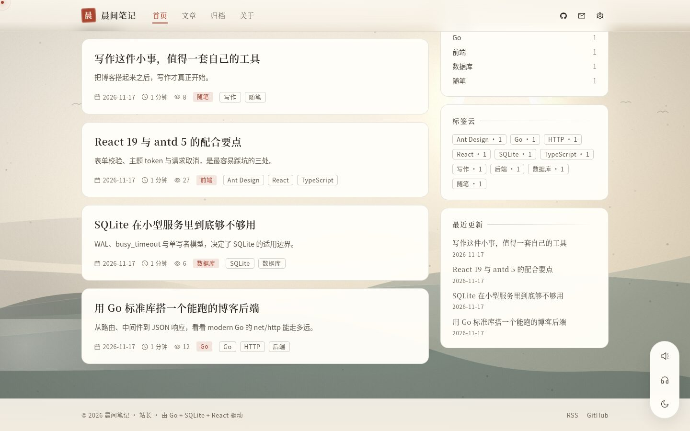 | 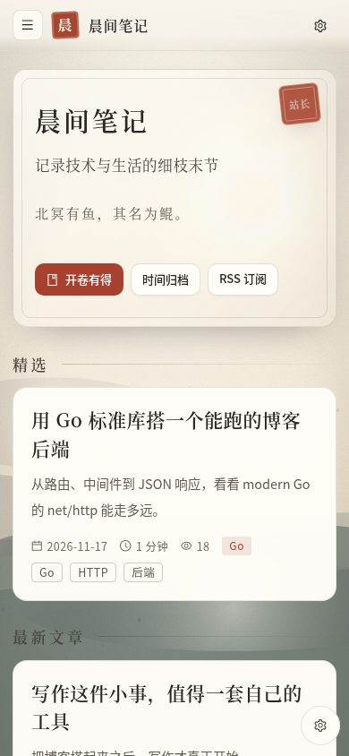 |

| 文章列表 | 文章详情 |
| --- | --- |
| 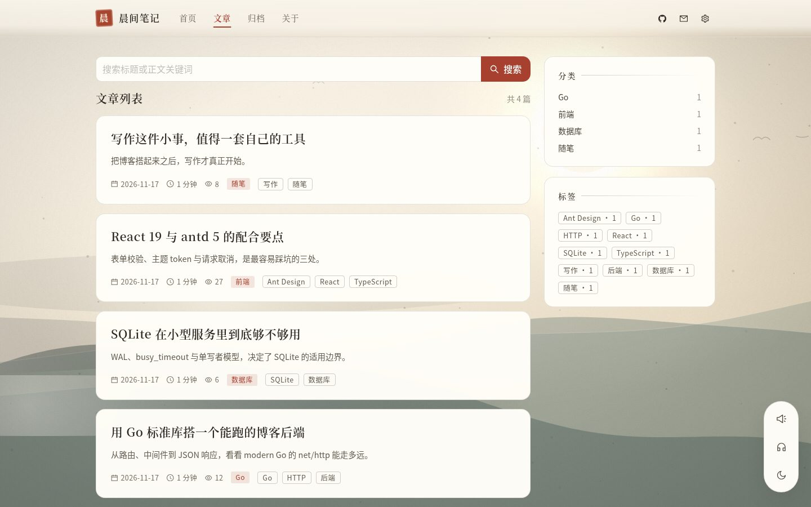 | 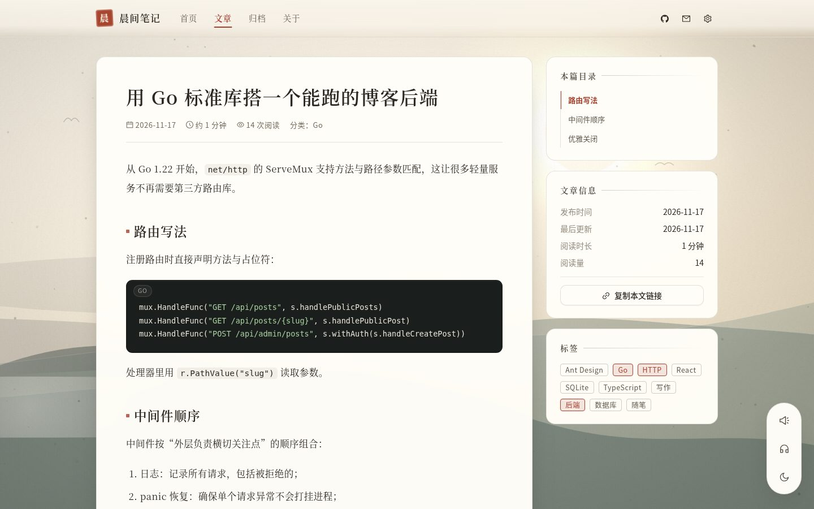 |

| 代码高亮（昼） | 代码高亮（夜） |
| --- | --- |
| 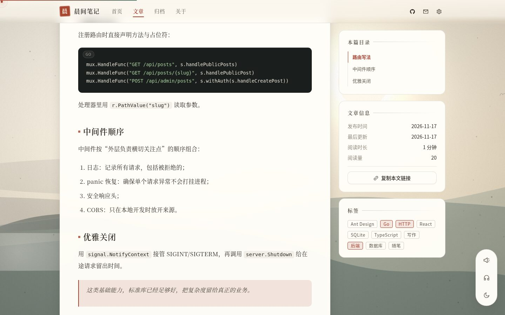 | 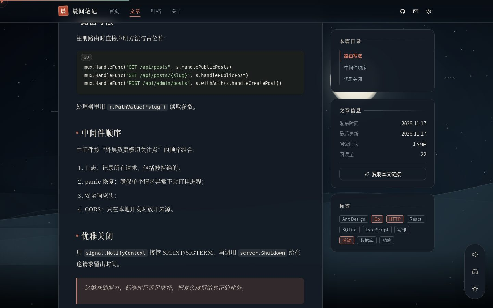 |

| 时间归档 | 关于页 |
| --- | --- |
| 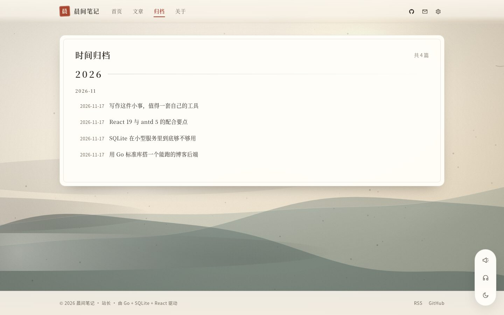 | 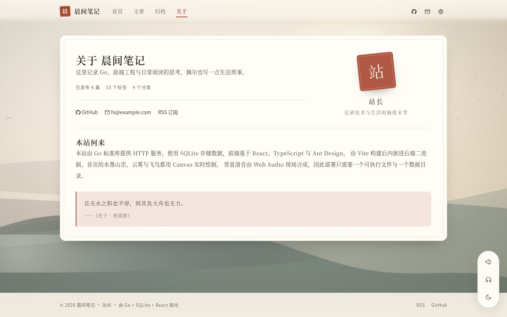 |

| 评论区 | 登录 |
| --- | --- |
| 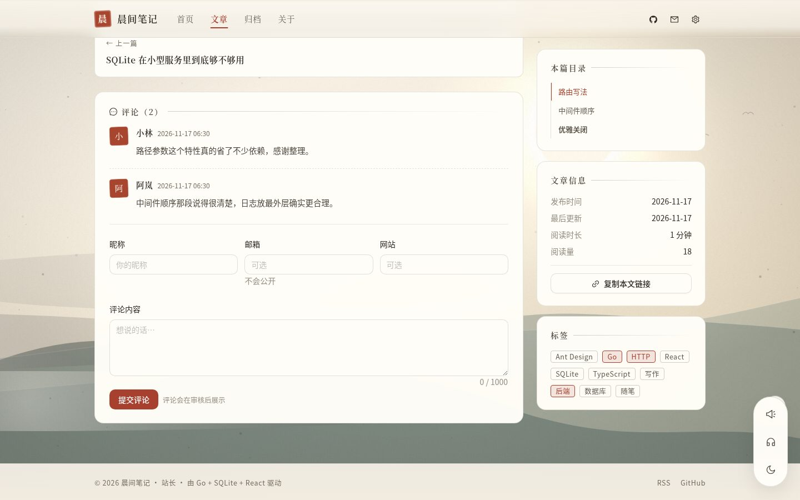 | 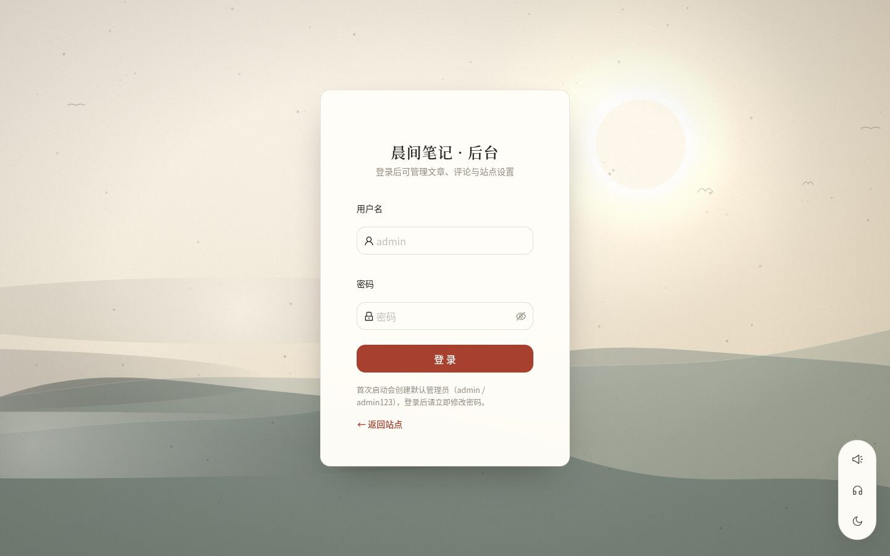 |

### 后台

| 概览 | 文章管理 |
| --- | --- |
| 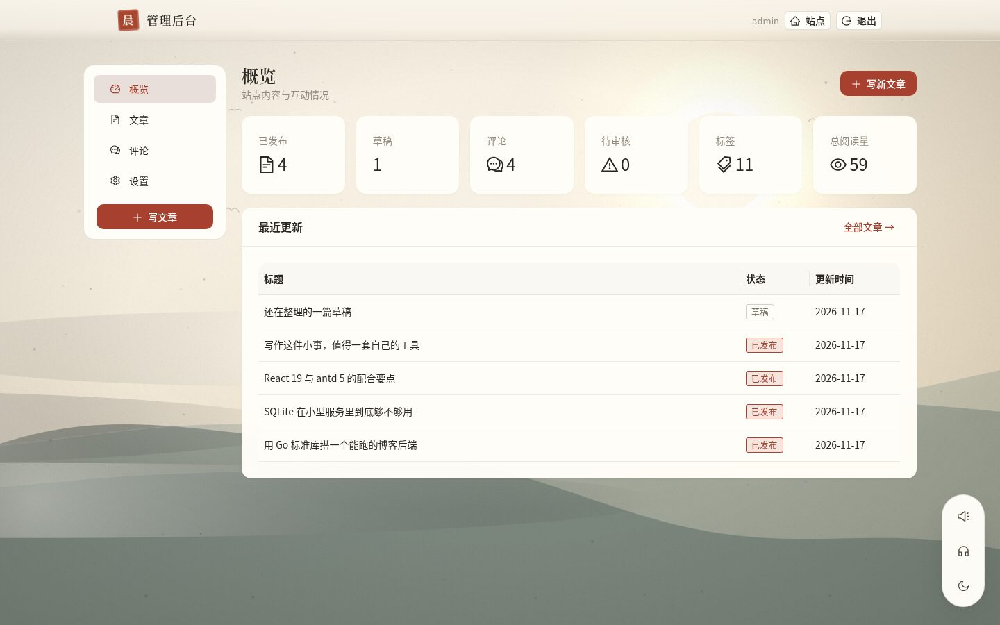 | 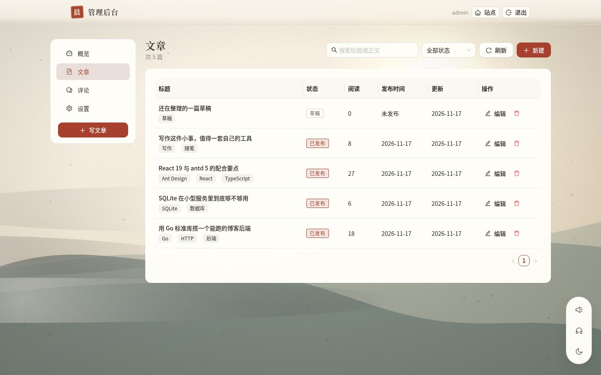 |

| 文章编辑（分栏预览） | 评论审核 |
| --- | --- |
| 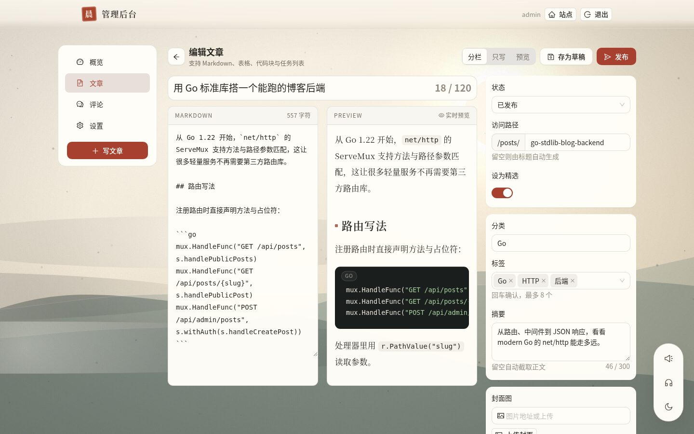 | 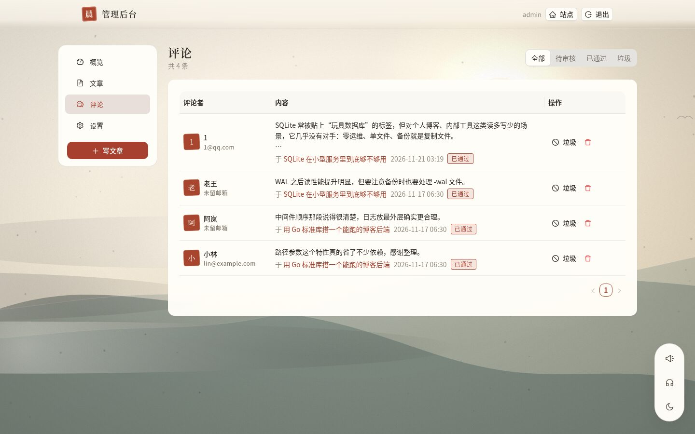 |

| 站点设置 | 首页卷首配置 |
| --- | --- |
| 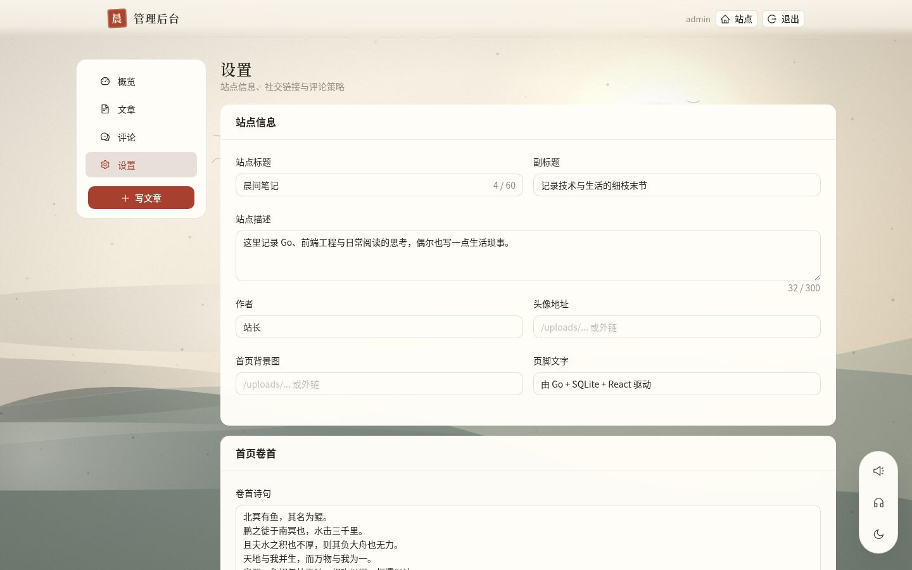 | 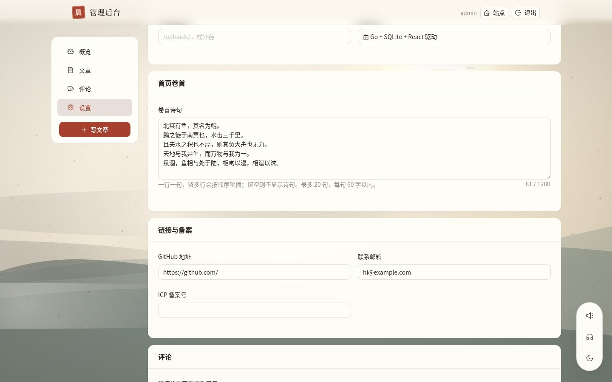 |

## 快速开始

### 从发布包启动并登录后台

解压后在终端运行 `./goblog`（Windows PowerShell：`.\goblog.exe`）。默认访问 [博客首页](http://127.0.0.1:8080/)；管理后台入口是 [http://127.0.0.1:8080/admin/login](http://127.0.0.1:8080/admin/login)。如果修改了监听端口或通过域名访问，在对应站点地址后加 `/admin/login`。

空数据目录首次启动时会自动创建管理员。未配置环境变量时，用户名为 **`admin`**，密码为 **`admin123`**。请先在本机登录，在「设置 → 修改密码」中改掉默认密码，再对外开放。也可以在首次启动前设置 `GOBLOG_ADMIN_USER` 和 `GOBLOG_ADMIN_PASSWORD`；这两个变量不会重置已有账号。

每次启动日志都会提示后台路径。只有新建管理员且使用内置默认密码时，日志才会显示默认密码；通过环境变量配置的密码不会写入日志。

### 源码开发依赖

- Go 1.26+（`go.mod` 要求 `go 1.26.0`；若本机 Go 较旧，可设 `GOTOOLCHAIN=auto` 让工具链自动下载）
- Node.js 20+ 与 npm

国内网络环境下的镜像配置：

```bash
go env -w GOPROXY=https://goproxy.cn,direct
go env -w GOSUMDB=sum.golang.google.cn
npm config set registry https://registry.npmmirror.com
```

### 开发模式

```bash
# 终端一：后端（:8080）
make server

# 终端二：前端（:5173，已代理 /api、/uploads 与 /rss.xml）
cd web && npm install && npm run dev
```

等价的直接命令（在项目根目录执行；`go run` 需指定绝对数据目录，避免使用临时二进制旁的目录）：

```bash
GOBLOG_DATA_DIR="$PWD/data" go run ./cmd/server
# 另一个终端
cd web && npm install && npm run dev
```

开发模式下从前端开发服务器进入后台：[http://127.0.0.1:5173/admin/login](http://127.0.0.1:5173/admin/login)。

### 生产构建

```bash
make all      # 前端构建到 internal/webassets/dist，再编译 bin/goblog
./bin/goblog  # 单进程同时提供 API 与前端
```

打开 <http://127.0.0.1:8080>。

> 前端构建产物不入库（`internal/webassets/dist/` 仅保留占位文件）。直接 `go build` 前必须先 `npm run build`，否则 `embed` 找不到可嵌入文件。

等价的直接命令：

```bash
cd web && npm run build     # 输出到 ../internal/webassets/dist
cd .. && go build -trimpath -ldflags="-s -w" -o bin/goblog ./cmd/server
```

写入示例内容（默认写到项目根目录的 `data/`，与 `make server` 和 `make dev` 一致）：

```bash
make seed      # 或 GOBLOG_DATA_DIR="$PWD/data" go run ./cmd/seed
```

如果希望示例内容写到 `./bin/goblog` 的默认库，使用 `GOBLOG_DATA_DIR="$PWD/bin/data" make seed`。

## 配置

全部通过环境变量，均有默认值。

| 变量 | 默认值 | 说明 |
| --- | --- | --- |
| `GOBLOG_ADDR` | `:8080` | 监听地址 |
| `GOBLOG_DATA_DIR` | `./data` | 数据目录；相对路径以可执行文件所在目录为基准，绝对路径直接使用。启动日志显示解析后的绝对路径 |
| `GOBLOG_UPLOAD_DIR` | `$DATA_DIR/uploads` | 上传目录 |
| `GOBLOG_JWT_SECRET` | 首次启动生成到 `$DATA_DIR/jwt.secret` | JWT 签名密钥 |
| `GOBLOG_TOKEN_TTL_HOURS` | `168` | 令牌有效期（小时） |
| `GOBLOG_ADMIN_USER` | `admin` | 初始管理员用户名（仅在无账号时生效） |
| `GOBLOG_ADMIN_PASSWORD` | `admin123` | 初始管理员密码（仅在无账号时生效） |
| `GOBLOG_SITE_URL` | 空 | 站点外部地址，用于 RSS/sitemap 的绝对链接；留空按请求推断 |
| `GOBLOG_CORS_ORIGIN` | 空 | 允许的跨域来源，如 `http://127.0.0.1:5173` |
| `GOBLOG_DEBUG` | `false` | 打开 debug 日志 |

## 目录结构

```
cmd/server/            程序入口：配置、数据库、路由、优雅退出
cmd/seed/              示例数据写入
internal/config/       环境变量配置
internal/database/     连接池与内嵌 schema.sql
internal/model/        领域与 API 结构
internal/store/        数据访问层（唯一允许出现 SQL 的地方）
internal/service/      业务层：鉴权、文章、评论、设置、上传
internal/markdown/     Markdown 渲染、纯文本摘要、阅读时长
internal/httpapi/      路由、中间件、处理器、RSS、静态资源
internal/webassets/    前端产物 embed
web/                   React + TS + antd 源码
  src/components/      通用组件（页头页脚、阅读进度、目录、浮坞…）
  src/pages/           前台页面
  src/pages/admin/     后台页面
  src/lib/             useAsync、Markdown、高亮、剪贴板、目录提取
  src/effects/         Canvas 水墨山水
  src/theme/           antd 主题 token（昼夜两套）
  src/index.css        全站样式
data/                  运行时数据（不入库）
images/                README 截图
```

依赖方向单向：`cmd → httpapi → service → store → database`；`model`、`markdown`、`webassets` 为底层公共包。

## API 概览

公开接口：

```
GET    /api/health
GET    /api/site
GET    /api/posts?page&pageSize&tag&category&q&featured
GET    /api/posts/{slug}
GET    /api/posts/{slug}/comments
POST   /api/posts/{slug}/comments
GET    /api/tags
GET    /api/categories
GET    /api/archive
GET    /api/comments/recent?limit
GET    /rss.xml
GET    /sitemap.xml
```

鉴权接口（`Authorization: Bearer <token>`）：

```
POST   /api/auth/login
GET    /api/auth/me
POST   /api/auth/password
GET    /api/admin/stats
GET    /api/admin/posts?status
POST   /api/admin/posts
GET    /api/admin/posts/{id}
PUT    /api/admin/posts/{id}
DELETE /api/admin/posts/{id}
GET    /api/admin/comments?status&postId
PATCH  /api/admin/comments/{id}
DELETE /api/admin/comments/{id}
GET    /api/admin/settings
PUT    /api/admin/settings
POST   /api/admin/uploads
```

错误统一为：

```json
{ "message": "请求参数不合法", "fields": { "title": "请输入文章标题" } }
```

## 测试

```bash
make test     # go vet + go test + 前端类型检查
```

等价的直接命令：

```bash
go vet ./... && go test ./...
cd web && npm run typecheck
```

后端测试使用临时目录中的真实 SQLite 文件，覆盖鉴权、文章生命周期、草稿隔离、别名冲突、评论审核、设置持久化（含卷首诗句的行规整与句数上限）、RSS/sitemap 与 SPA 回退。

前端除类型检查外，改动样式或交互后还应重新 `npm run build` 并在浏览器里验证实际渲染——编译通过不代表运行时行为正确。

## 部署

### 直接运行

直接运行 `bin/goblog` 默认使用二进制旁的 `bin/data/`，与终端当前目录无关。数据目录存放 `goblog.db`、`jwt.secret` 和默认的 `uploads/`。请保留该目录；`make clean` 只清理本地编译的二进制和前端产物，不删除数据或发布包。

从旧版本升级时，已有数据不会自动移动。若此前的数据目录是启动位置下的 `data/`，请将 `GOBLOG_DATA_DIR` 设为那个目录的绝对路径，再启动新版，以继续使用原数据库、密钥和上传目录。

如需反向代理，建议在代理层终止 TLS 并设置 `GOBLOG_SITE_URL`，这样 RSS 与站点地图里的链接才是正确的绝对地址。

### Docker

仓库提供两阶段构建的 `Dockerfile` 与 `docker-compose.yml`：先在 Node 阶段构建前端，再在 Go 阶段编译并嵌入产物，最终镜像只保留二进制。

```bash
docker compose up -d --build
```

compose 默认把 `./data` 挂到容器的 `/data`，并把管理员密码设为 `change-me-please`——请在上线前改掉。

> `Dockerfile` 目前使用 `golang:1.24-alpine` 基础镜像，而 `go.mod` 要求 `1.26.0`，首次构建前需要把该基础镜像标签升到 1.26（该组合尚未在本机构建验证）。

## 数据模型

- `users`：管理员账号（bcrypt 哈希）
- `posts`：文章，含渲染后的 HTML、阅读量与发布时间
- `tags` / `post_tags`：标签与多对多关联
- `comments`：评论，状态为 `pending` / `approved` / `spam`
- `settings`：站点配置键值对（含卷首诗句 `verses`）

时间字段统一以 RFC3339 UTC 字符串存储，便于字典序排序与跨客户端一致。

## 许可证

本项目使用 [Apache License 2.0](LICENSE) 授权。

你可以自由使用、修改和分发本项目（包括商业用途），但需保留版权声明与许可证副本，并在修改过的文件中标明变更。软件按“现状”提供，不附带任何明示或默示的担保。

```
Copyright 2026 The goblog Authors

Licensed under the Apache License, Version 2.0 (the "License");
you may not use this file except in compliance with the License.
You may obtain a copy of the License at

    http://www.apache.org/licenses/LICENSE-2.0

Unless required by applicable law or agreed to in writing, software
distributed under the License is distributed on an "AS IS" BASIS,
WITHOUT WARRANTIES OR CONDITIONS OF ANY KIND, either express or implied.
See the License for the specific language governing permissions and
limitations under the License.
```

## 已知限制

- `Makefile` 的 `web` 目标缺少规则头（`.PHONY: web` 之后直接跟缩进命令），GNU make 会报 `recipe commences before first target`；在此修复前请用上文给出的直接命令。
- 仅在 Chromium 上做过端到端验证，Firefox / Safari 未测。
- 后台没有批量发布 / 转草稿能力（后端也未提供批量接口）。
